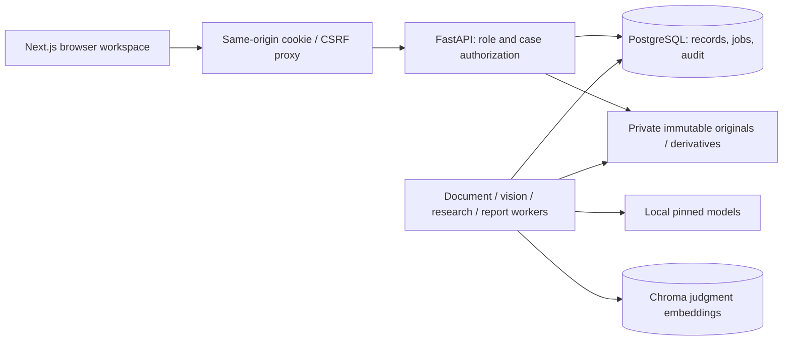
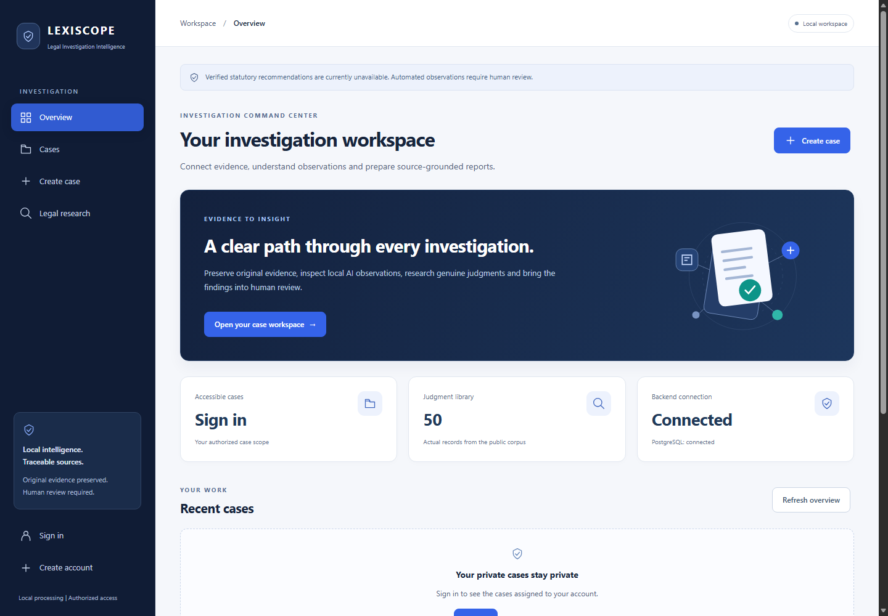

# LEXISCOPE - AI Legal Evidence Analysis System

A local academic investigation workspace for authorized case evidence, source-linked AI observations, genuine judgment retrieval and immutable reports with human review. The Next.js interface connects to real FastAPI/PostgreSQL services; inference stays local. AI outputs assist investigation and require human verification. They do not establish guilt, intent, admissibility or legal applicability.

**Verified statutory recommendations are currently unavailable.** Imported BNS, BNSS, BSA and legacy provision counts are zero. The judgment corpus contains 50 authentic historical judgments with 3,834 embeddings; it is not current-law coverage.

## Run the existing configured application

Requirements: Windows with Docker Desktop running Linux containers and Docker Compose; existing configured `.env`, PostgreSQL volume, ignored private storage and previously built images/models. Node.js 22+ and Python 3.13 are needed for native development checks, not ordinary Compose startup.

From the repository root in PowerShell:

```powershell
docker compose up --no-build --wait --wait-timeout 180
```

- Application: **http://localhost:3000**
- Backend API documentation: **http://localhost:8000/docs**
- PostgreSQL: loopback port 5433 (the host's existing 5432 service is unaffected).

Retain `.env`, `.local/phase2` and the PostgreSQL volume. Do not reset private storage or use `down -v`. Normal startup reuses installed models and data and never needs to ingest the corpus again. `docker compose ps --all` shows seven long-running healthy services; the one-shot migration service exits successfully.

After changing frontend source only:

```powershell
docker compose build --pull=false frontend
docker compose up --no-build --no-deps --wait --wait-timeout 120 frontend
```

A fresh clone does not contain private runtime data, models or credentials. Copy `.env.example` to `.env` only if no real `.env` exists, configure your own strong database secret, then build/start using `docker compose up --build --wait --wait-timeout 180`. The first build requires network access and substantial CPU dependencies. Acquire models/data only through the existing reviewed, pinned operator workflows after required download approval. See [source acquisition](SOURCES.md), [model register](AI_MODELS.md), and the phase reports for exact provenance, licenses, hashes and byte limits. A clone without those files honestly reports model/corpus unavailability; it does not fabricate them. For the full AI stack, use Docker rather than the earlier core-only native fallback.

## Demonstration walkthrough

1. **Register / sign in.** Public registration creates a legal researcher. Password visibility, validation and error messages preserve the existing cookie/JWT authentication.
2. **Command center.** Read live accessible-case totals, genuine judgment count and backend readiness. For signed-in users, evidence totals and research/report work queues cover the latest three accessible cases; the scope is labeled. Audit activity appears only where the account has permission.
3. **Create a case.** Enter your own title, description, jurisdiction and dates. Use the anchored workspace sections: Overview, Evidence & AI analysis, Legal research, Reports & review, Access & audit.
4. **Upload evidence.** Browse or drop one authorized PDF, PNG, JPG/JPEG or MP4 and enter genuine provenance. The UI shows actual upload stages rather than an invented percentage. Client/server SHA-256 values are compared. Originals are immutable, validated and privately stored.
5. **Document intelligence.** Choose Analyze Evidence, wait for the real job, then View Analysis. Read extracted text, page references, source hashes, exact entity offsets, model metadata and genuine reported scores. Selecting a stored entity highlights its stored Unicode code-point span.
6. **Visual intelligence.** Choose Analyze Image / Analyze Video, then View Results. Inspect verified source/annotated derivatives, actual object candidates and source-pixel boxes. Video controls move between sampled frames and show actual timestamps; this is not continuous tracking or identity recognition.
7. **Research.** Public Legal research searches genuine judgment passages. In an authorized case, an investigator/lawyer/administrator can select completed extraction spans or explicitly reviewed input, start local research and record attributed relevance annotations. Inspect exact queries, source URLs, pages, offsets and hashes. Similarity is not legal correctness.
8. **Reports and review.** An authorized investigator/lawyer/administrator generates a private immutable PDF/snapshot. Inspect provenance and audit, preview/download with hash verification, and record a note. An authorized lawyer/administrator can explicitly approve/reject a draft. The decision is hash bound and separate from the immutable PDF; revisions require another version.
9. **Log out.** Use the identity panel or sidebar. Refresh/session/logout and CSRF behavior remain intact.

Only use real evidence you are authorized to handle. The verification flow reuses existing licensed public-source copies and clearly labeled user-created test case metadata, never fabricated allegations.

## Authentication and permissions

Case ownership/membership is checked on every private backend endpoint. Owners manage their cases and collaborators; investigators/lawyers can write assigned active cases; researchers assigned to another person's case have read-only access. Public registration cannot select or elevate roles. Report generation/research initiation also require a permitted professional role; approval/rejection additionally requires a lawyer/administrator.

To bootstrap the intended first administrator, register that account and run the existing trusted local operator command (it refuses if an active administrator exists):

```powershell
docker compose exec -T backend python -m app.manage_users YOUR_REGISTERED_EMAIL --bootstrap-administrator
```

Use the documented trusted administration workflow for investigator/lawyer roles. Never publish credentials. See [security and access policy](docs/SECURITY.md) for the complete matrix, session handling, private storage and operator boundaries. Public judgment search remains public; evidence, analysis, artifacts, research history and reports require case access.

## Architecture and AI pipeline



The seven services are frontend, backend, PostgreSQL and separate document, visual, research and report workers. PostgreSQL jobs retain attempts, progress, errors, worker leases and restart-safe history. Uploads/API requests do not run inference. Originals, derived artifacts and report snapshots have distinct private namespaces. Source hashes are checked before processing and when downloading.

- **PDF / OCR:** pypdf embedded text; PDFium rendering and Tesseract English OCR for scanned pages/images. Exact pages, text hashes and real OCR score provenance are retained.
- **NLP:** pinned Apache-2.0 `dslim/distilbert-NER` plus deterministic date/time/document-reference rules. Entities retain source spans/offsets and model/rule provenance.
- **Vision:** pinned Apache-2.0 OpenCV Zoo YOLOX-S ONNX, OpenCV CPU inference and documented MP4 sampling. No facial identification, person re-identification or guilt prediction.
- **Retrieval:** pinned Apache-2.0 `all-MiniLM-L6-v2`, Chroma and exact SQL source passages. No external LLM or paid service.
- **Reports:** deterministic source compilation using ReportLab, with versioned PDF and canonical source snapshots, hashes and append-only attributed review records.

Exact model revisions, software versions, licenses and source limits are retained in [AI_MODELS.md](AI_MODELS.md), [SOURCES.md](SOURCES.md), [architecture](ARCHITECTURE.md), [schema](DATABASE_SCHEMA.md), [API reference](docs/API.md), and the [Phase 4](docs/PHASE4_DESIGN.md), [Phase 5](docs/PHASE5_DESIGN.md), [Phase 6](docs/PHASE6_DESIGN.md) and [Phase 7](docs/PHASE7_DESIGN.md) records. Original CSS/SVG interface artwork adds no third-party assets, remote fonts or dependencies.

## Verification and screenshots

[Final delivery report](docs/FINAL_DELIVERY_REPORT.md) records actual focused verification, screenshots, preservation checks and limitations. [TESTING.md](TESTING.md) retains the full history, including failures and corrections. The prior complete backend suite was **135 passed, 0 failed, 1 deliberately skipped**, two upstream warnings; it is reused for this frontend-only delivery rather than represented as a new run. The skipped authentic-statute test remains data-gated by unverified rights/access/version metadata.

Relevant commands (run only when verification is needed):

```powershell
npm --prefix frontend run typecheck
backend/.venv/Scripts/python.exe scripts/smoke.py
docker compose ps --all
# Full corpus/database regressions, when backend changes justify a rerun:
docker compose exec -T -e RUN_DB_TESTS=1 -e RUN_CORPUS_TESTS=1 backend python -m pytest -q -p no:cacheprovider
```



[Desktop sign-in](docs/screenshots/final-login.png) | [Mobile registration](docs/screenshots/final-mobile-registration.png)

Screenshots and measured final results are listed in the final report. Private case/evidence screenshots stay in ignored local storage; only explicitly reviewed anonymous interface captures may be published.

## Known limitations and safe interpretation

The English historical corpus is small. Statutes are unavailable. Earlier narrow NER evaluation matched **1 of 6 checked person mentions**, not general model accuracy. OCR word confidence and YOLO scores are uncalibrated and do not establish factual correctness. Videos are sampled, not continuously tracked. Human review is mandatory. PDF approval is external/hash bound; complex-script shaping, PDF/A and digital signatures are not provided.

This is a local academic application, not a verified production deployment. Production TLS/secure cookies, MFA/account recovery, malware scanning, host ACL review, quotas, independent audit retention, backup/restore policy and deployment security review remain unresolved requirements. Custom secret/access tests are not a full dependency-CVE audit or penetration test. Services remain bound to loopback; private data and models must stay out of Git.

## Repository and delivery history

Existing public origin: `https://github.com/yashvardhanshah/AI-Legal-Evidence-Analysis-System.git`, branch `main`. Phases 1-8 are committed; Phase 8 base is `38c5b63147779e14f65a1d2310947f47d1cd704c`. [Implementation plan](IMPLEMENTATION_PLAN.md) and individual phase reports preserve the development history. This final delivery is a product-completion task, not another phase. Every commit/push still requires explicit owner approval. Review exact staged content and ignore checks before publication; no original evidence, dataset, model, environment file, credential, private report or database volume belongs in Git.
